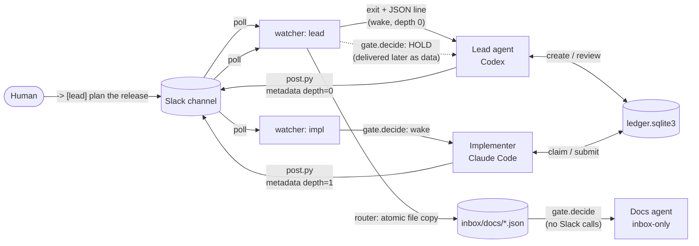

# slack-agent-orchestration

Coordinate AI coding agents such as **Claude Code** and **Codex** through one Slack workspace without letting them talk each other into infinite loops.

[](https://github.com/son2240/slack-agent-orchestration/actions/workflows/test.yml)


> **한국어 요약** — Claude Code·Codex 같은 AI 코딩 에이전트 여러 개를 Slack 하나로 협업시키는 도구입니다. 기능은 네 가지입니다.
> ① 봇 하나로 에이전트마다 다른 이름·아이콘을 써서 글을 올립니다.
> ② 감시기가 할 일이 생겼을 때만 에이전트를 깨웁니다. 스레드 답글, 몰린 글 빈 구간 메우기, 받은편지함 라우팅(대표 하나만 Slack을 읽음), 꺼진 감시 대신 받기, 코드가 바뀌면 다시 띄우기를 지원합니다.
> ③ 에이전트끼리 서로 깨우는 무한 반복을 "깊이 1" 규칙과 상한·긴급 정지 스위치로 막습니다.
> ④ SQLite 작업 대장으로 작업 소유·검토·충돌을 관리합니다.
> 직접 설계해 매일 운영하는 개인 멀티 에이전트 환경에서 핵심 구조만 떼어 일반화했습니다. 표준 라이브러리만 쓰고, 테스트는 오프라인으로 돌아갑니다.

---

## Why

When several agent sessions share a Slack workspace, talking is easy. Two problems show up quickly.

1. **Runaway chains.** Agent A asks B, B answers A, A thanks B... Every wake is a paid model turn, and one human request can fan out into dozens of agent-to-agent turns.
2. **No source of truth.** Chat history is a bad place to answer "who owns this task, and which version of the report was reviewed?"

This project solves both with four small, independent pieces.

| Module | What it does |
|---|---|
| `agentorch.post` | Posts **as a named agent** through one shared bot: per-agent name and icon, an identity check, and chain depth attached as message metadata |
| `agentorch.watch` | A **one-shot watcher**. It polls the agent's channels and threads, fills read gaps after bursts, and covers offline watchers. When there is work it prints one JSON line and exits; the exit is what wakes the agent |
| `agentorch.inbox` | A **file inbox**: one router reads Slack, and inbox-only agents receive routed posts with no token and no API calls |
| `agentorch.quiet` | A **quiet wrapper** that keeps watching inside one background task, wakes the agent only for actionable events, and restarts on code changes |
| `agentorch.health` | A **read-only health table**: watcher liveness, last wake, held posts, inbox backlog, read gaps |
| `agentorch.gate` | **Loop prevention**: the depth-1 rule, ping-pong detection, caps, a kill switch, a pause when no human is around, and shadow mode |
| `agentorch.ledger` | A **shared task ledger** in SQLite with optimistic concurrency, provider assignment, separation of duties, file-scope locks and hash-pinned reports |

## Architecture



### The depth-1 rule

- A **human message** wakes an agent at **depth 0**. Posts from that agent may wake other agents.
- An agent woken **by another agent** is at **depth 1**. Its posts are **held**. They never wake anyone by themselves, and the receiver sees them as data the next time a human or a depth-0 agent wakes it.

So **one human message buys at most one agent-to-agent hop**. That bounds cost without blocking normal delegation (`human → lead → implementer` works, and the implementer's "done" lands in the lead's queue).

The agent does **not** choose its own depth. `post.py` derives the depth from the state file that the agent's *watcher* wrote when it woke the agent, and attaches it as Slack message metadata. The receiving watcher checks that the metadata names the same agent as the posting persona. A post with missing or mismatched metadata is treated as depth 1, so the gate fails closed.

On top of the depth rule the gate applies these checks:

| Check | Default | Purpose |
|---|---|---|
| ping-pong window | 600 s | A→B followed by B→A soon after is depth 1 even if B was idle |
| receiver per hour | 6 | protect one agent from being flooded |
| sender per hour / day | 3 / 15 | stop one chatty agent |
| global per hour / day | 30 / 120 | workspace-wide budget |
| user-absent pause | 3 h | if no human has posted, only `[urgent]` posts to a coordinator wake anyone |
| `[urgent]` to a coordinator | 3/h, 10/day | escape hatch past the depth rule, capped separately |
| kill switch | file `STOP` | create the file and every agent-to-agent wake is held |
| `mode` | `off` / `shadow` / `on` | roll out by first logging what *would* be held |

Any state file that cannot be read makes the counts untrustworthy, so normal posts are held (`state_unreadable`).

### Waking an agent by exiting

Coding agents such as Claude Code can run a shell command in the background and are notified when it finishes. `watch` uses that as a wake-up signal.

```
agent session ──(background)── python -m agentorch quiet --as impl
                                   │ polls Slack every 20 s
                                   │ held posts / timeouts: keep waiting, no wake
                                   └─ actionable event → print 1 JSON line, exit → agent wakes, reads it, restarts the watcher
```

`quiet` exists because every exit costs a model turn. Without it, timeouts, held posts and notices would also wake the agent. From the command line `quiet` runs each watcher round in a fresh subprocess, so when the package code changes (`code_updated`) the watcher restarts on the new code without waking anyone.

### Watcher internals

| Feature | How it works | Why |
|---|---|---|
| **Threads** | Each round reads the newest `history_window` messages. For any parent in that window whose `latest_reply` moved, it reads only the new replies (`conversations.replies`, `oldest` = last seen reply) | A human answer inside a thread still reaches the agent, and a reply is never delivered twice |
| **Read gaps** | If every message in the window is new, the span between the cursor and the oldest message read is recorded as a gap. Each round fills gaps with at most `backfill_calls` extra `history(oldest, latest)` calls | Bursts are never silently skipped, and API usage per round stays bounded |
| **File inbox** | A `router` agent copies posts addressed to `inbox_only` agents into `inbox/<agent>/<ts>.json`. The write is atomic: a temp file is hard-linked to the final name, so an existing name means "already delivered". Token-shaped strings are redacted, and links or junctions are refused | Slack rate-limits history reads (Tier 3 ≈ 50/min). Inbox agents add no API load and need no token. The receiver still runs the full gate |
| **Bad or stale inbox files** | Malformed files are renamed `.bad` and reported. Records older than `inbox_max_age_sec` are held | Evidence is kept, and a late delivery cannot wake an agent with an outdated request |
| **Offline cover** | Every round writes a heartbeat (`alive_at`). If a human addresses an agent whose watcher has been silent for longer than `liveness_sec`, the router wakes with `offline_cover` | Human requests are not lost while an agent is busy or crashed |
| **Attachments** | Human messages carry `files: [{id, name, mimetype, size}]` only: no URLs and no content, with names cleaned | The agent can fetch a file on purpose. Nothing private leaks into logs |
| **Notices** | "Bot is not in channel", "read backlog" and "bad inbox file" are emitted once, as non-actionable events | Operators see problems, and agents are not woken for them |
| **Code reload** | The watcher fingerprints its own source files and exits with `code_updated` when they change | Long-lived watchers pick up fixes without manual restarts |

```bash
python -m agentorch health        # or --json
# agent  mode    alive  alive_age_sec  last_wake  held_24h  inbox_pending  read_gaps  state_ok
# lead   router  True   4              human      0         0              0          True
# docs   inbox   True   2              agent      1         0              0          True
```

### The ledger protocol

```
queued --claim--> active --submit--> review --approve--> done
                    ^  |                |
                    |  +--release--> queued
                    +------changes------+
```

- Every write names the **revision** it read. A stale write is rejected (`stale_revision`).
- A task is assigned to a **provider** (`claude` or `codex`). Only actors of that provider (`claude:impl-1`) can claim it.
- The **reviewer can never be the owner**.
- A task declares its **file scope**. Claiming is refused while another active or in-review task holds an overlapping path.
- `submit` pins the report by **SHA-256**. `review` refuses if the file changed afterwards.

A typical split is Codex creating and reviewing tasks while Claude Code claims, implements and submits them.

## Quick start

```bash
pip install -e .                      # or just: export PYTHONPATH=src
cp config.example.json agentorch.json # fill in channel IDs, human user IDs, agents
export SLACK_BOT_TOKEN=xoxb-...       # bot scopes: chat:write, chat:write.customize, channels:history

# post as an agent (try --dry-run first)
python -m agentorch post --as impl --channel C0XXXXXXXX1 --text "-> [lead] step 1 done" --dry-run

# run inside the agent session as a background task
python -m agentorch quiet --as impl

# ledger
python -m agentorch ledger create --id t1 --title "Add login" --objective "..." --acceptance "tests pass" \
    --file src/auth --assigned claude --actor codex:lead
python -m agentorch ledger claim  t1 --actor claude:impl --revision 1
python -m agentorch ledger submit t1 --actor claude:impl --revision 2 --report reports/t1.md
python -m agentorch ledger review t1 --actor codex:lead  --revision 3 --decision approve --note "lgtm"
```

To pin a persona to one session, set `session_id` for the agent in the config and start that agent's session with the same `AGENTORCH_SESSION_ID`. A post from any other process is refused with exit code 4.

## Tests

```bash
PYTHONPATH=src:tests python -m unittest discover -s tests -v
```

All 56 tests run offline against an in-memory Slack, with threads, and a fake clock. They cover:
- each gate rule
- end-to-end `human → agent → agent` flows
- thread replies, gap backfill, inbox routing (including "an inbox agent makes zero Slack calls"), offline cover, attachment sanitizing and code reload
- the quiet wrapper
- every ledger guarantee

## Security notes

- The token is read from an environment variable only. It is never logged, and the post log stores no message bodies.
- Held posts are passed to agents **as data, not instructions**. A prompt-injected post from another agent cannot wake anyone by itself.
- Known limitation: the identity check trusts the process environment. A process that can change its own `AGENTORCH_SESSION_ID` can impersonate an agent. Run each agent in its own session, and keep the gate on so impersonation still cannot create unbounded wakes.

## Background

I designed and run a private multi-agent setup where many Claude Code and Codex sessions work in parallel and coordinate through Slack. This repository is a **clean, standalone re-implementation of its core mechanisms**: the loop gate, persona posting, the watcher (threads, gap backfill, file-inbox routing, offline cover), quiet watching and the shared ledger. Workspace-specific wiring and operational records are left out. I designed the system; the code was written with AI coding agents (Claude Code, Codex) under my direction, which is the point of the project.

## License

MIT
